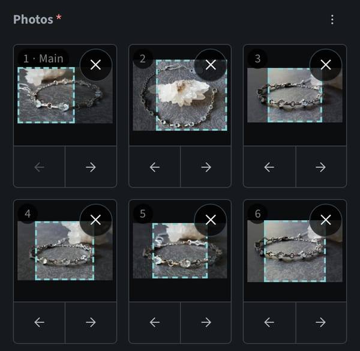
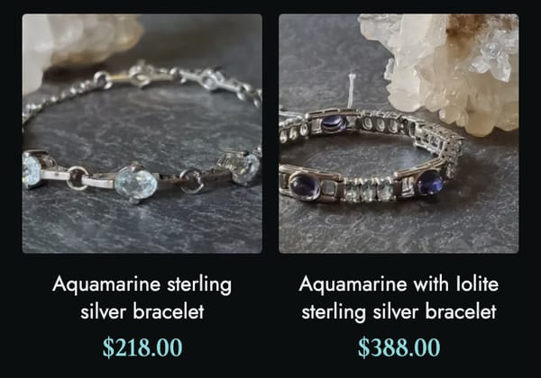
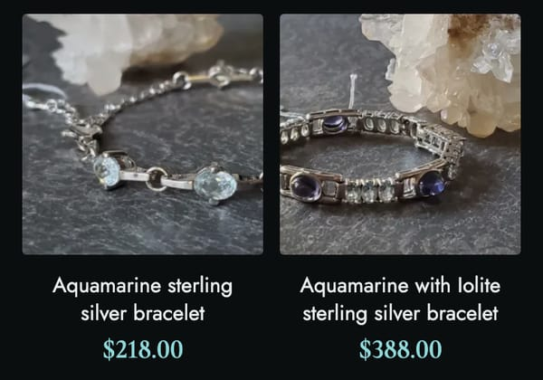
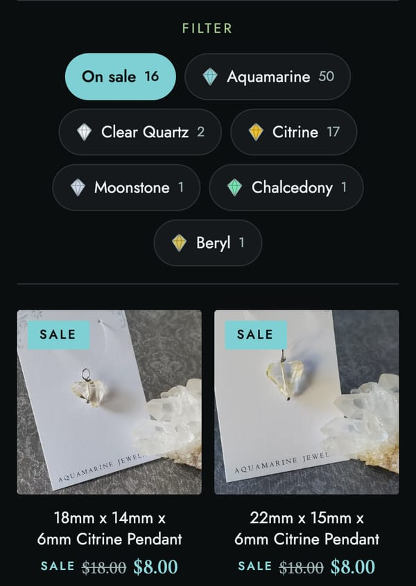
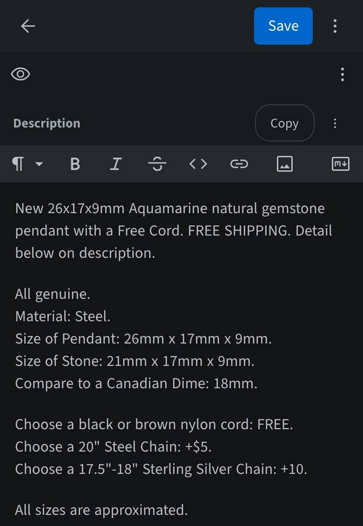

# Two more weeks: four features and a faster build

After the [first three changes](AFTER-LAUNCH.md), the owner kept going. Between October 2 and October 16 the owner made 196 saves from a phone and filled the shop to 69 pieces. Using the site every day brought new requests, and the growing catalog brought a problem nobody had asked about: every save took longer to go live.

Each change below went the same way as before: an issue, a branch, a try on the dev site, a pull request into the live branch, and a tag before each release.

| What the owner said, or what I noticed | What changed |
|---|---|
| Square frames cut every photo at the centre; the owner wanted to choose what shows. | Each photo has a square to drag in the admin, to choose the part that shows. |
| The owner runs the shop from a phone. | The shop and the admin both install as apps on the phone's home screen. |
| Some pieces should be on sale, and visitors should notice. | A Sale switch: tags, a crossed-out price, a banner, and an "On sale" filter. |
| Every piece is retyped into Facebook Marketplace, and "Message on Facebook" opens a chat that is too general. | Copy buttons in the admin, and a Marketplace button on the product page. |
| A new piece took 13 to 22 minutes to appear. | Builds are back to under a minute. |

## 1. Choosing each photo's crop

The site shows photos in square frames: on product cards, on category tiles, as thumbnails and on the product page. The owner's photos are taken on a phone, so they are taller or wider than a square, and the site always cut them at the centre: a wide bracelet photo lost its ends, a tall pendant photo its top and bottom.

Each photo in the admin now has a dashed square. The owner drags it along the photo's long side to choose what the frame shows.

| Choosing the crop in the admin | Before: centred | After: the chosen part |
|---|---|---|
|  |  |  |

- **The photo itself is never changed.** Only a position is saved, as a number from 0 to 100, and the site applies it when it shows the photo. Moving the square again costs nothing.
- **Positions follow the photo, not its place in the list.** They are stored by file name, so reordering photos does not mix them up.
- **A wrong value cannot break the shop.** A photo without a position, or with one that cannot be read, is simply centred. An earlier incident had taught me that one bad field in one product can stop the whole site from building.

## 2. The shop and the admin as phone apps

Both now install on a phone's home screen and open full screen, without the browser's address bar.

- **Two apps, two icons.** The shop is the stone from the logo; the admin is the same stone with a pencil, so the owner can tell them apart at a glance.
- **The shop caches almost nothing.** Without a connection it shows a short offline page. Everything else always comes fresh, so a new piece shows the moment its build is done.
- **The admin needed its own setup.** The admin tool offers installing on its own, but on Android that only produced a shortcut with a Chrome badge on the icon. A manifest of our own, and a small script so the browser uses it, gave a real app.
- **A Refresh button where there is none.** An installed app has no reload button and no pull-to-refresh. The admin app now has a round Refresh button in its top bar. It is hidden while a piece is being edited, so a tap cannot lose unsaved changes.

## 3. A Sale option

I showed three prototypes of how visitors would notice a sale. The one chosen uses all of it: tags, a banner and a filter. The owner used it the afternoon after the release, and sixteen pieces were on sale a week later.

| The "On sale" filter and the SALE tags | On the product page |
|---|---|
|  |  |

- **One switch, one optional field.** "On sale", and an "Original price" that, when filled in, is shown crossed out next to the new price.
- **Visitors notice.** While anything is on sale, a banner at the top of every page says how many pieces are, and links to them.
- **The filter is the same one as for crystals.** "On sale" is one more button in the filter row, with its count.
- **Sold pieces never count.** A piece that is sold keeps its page, but it is not on sale any more, so it gets no tag and no place in the banner's number.

## 4. Working with Facebook Marketplace

The owner sells through Facebook Marketplace, and posts each piece there as well. Two small changes connect the two.

- **Copy buttons in the admin.** The name, the price and the description each have a Copy button, so a listing can be filled in on the same phone by copy and paste. The description is copied as plain text, without formatting marks, and includes edits that are not saved yet.
- **A Marketplace button on the product page.** "Message on Facebook" opens a general chat, which is vague for a buyer asking about one piece. Each Marketplace listing has its own page where the buyer can message about that exact piece. So when a description contains the link to a listing, the product page shows "View/Order on Marketplace" as its main button instead. The link stays in the description, and a sold piece gets no Marketplace button, because Marketplace removes sold and old listings.

## 5. A build that grew from one minute to twenty

This one was not a request. When the site launched, a save in the admin was live in about a minute, and I wrote "about a minute" in several places, including these pages. Two weeks later it took 13 to 22 minutes. The build kept passing, so nothing looked wrong; the site was only slow to update.

The build logs showed two causes:

1. **The site was built twice on every build, from the very first one.** The deploy step looks for a configuration file. The project had none, so the deploy tool set the project up for Cloudflare by itself and built the whole site again. With a few photos that cost seconds, so nobody saw it.
2. **Every photo was resized from scratch, every time.** Astro saves its resized photos, and Cloudflare keeps that folder between builds. But the install step that runs before the build empties the folder, so nothing was ever reused.

Each photo is saved in about nine sizes, so the catalog meant 4,466 resized images per build, twice. The time grew with every piece the owner added:

| Date | One build |
|---|---|
| Oct 1 | 1 minute |
| Oct 4 | 3 minutes |
| Oct 7 | 4 to 7 minutes |
| Oct 10 | 8 to 15 minutes |
| Oct 15 | 14 to 22 minutes |

The fix was three small files: a configuration file so the deploy step only uploads the finished site, a build script that installs the packages without emptying the photo folder, and the caching rules that the automatic setup used to add. I tried it on the dev site first, where the first build took 7 minutes and the next one 66 seconds. On the live site:

| | Before | After |
|---|---|---|
| Builds of the site per save | 2 | 1 |
| Photos resized per save | 8,932 | only the new ones |
| From a save to live | 13 to 22 minutes | **52 seconds** |

A new piece now adds about a second per photo. One case stays slow: Cloudflare drops its saved copy after seven days without a build, and the next build then resizes everything once.

## How long it took

The times are when each change went live, Pacific time.

| When | What |
|---|---|
| Oct 2, 21:45 | Copy buttons in the admin |
| Oct 4, 11:36 | Choosing each photo's crop |
| Oct 5, 21:42 | The shop and the admin as phone apps |
| Oct 6, 18:01 | Marketplace button on the product page |
| Oct 8, 17:47 | Sale option |
| Oct 16, 14:04 | Issue opened for slow builds, with their two causes from the build logs |
| Oct 16, 19:20 | Faster builds released; 52 seconds confirmed the same evening |

The owner's work went on throughout: 196 saves in these two weeks, including 52 on a single day. None of them waited for a release.

## What went wrong, and how it was caught

| What happened | How it was caught |
|---|---|
| Builds slowed from 1 minute to 22 over two weeks, while every build passed. | By asking why a new piece took so long to appear. The build reports only said "success"; the build logs, read for the first time, showed the double build and that no photo was ever reused. |
| These pages said "about a minute" long after it stopped being true. | The same investigation. The tech stack page had even predicted that builds would slow down as the catalog grew, but nothing measured it. |

## What I took from it

- **A passing build is not a healthy build.** Success said nothing about time. Reading a build log once in a while would have shown the double build on the first day.
- **Small costs hide while a project is small.** Building twice cost seconds with a dozen photos and 20 minutes with hundreds. Growth is what turns a harmless default into a problem.
- **The owner's use is the best test.** A Sale option used the next day, and 52 saves in one day, showed what mattered faster than any plan.

---

The source code and the shop's content are kept in a private repository. Back to the [README](README.md).
